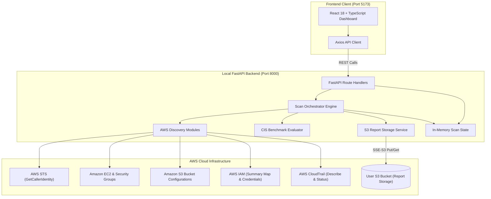
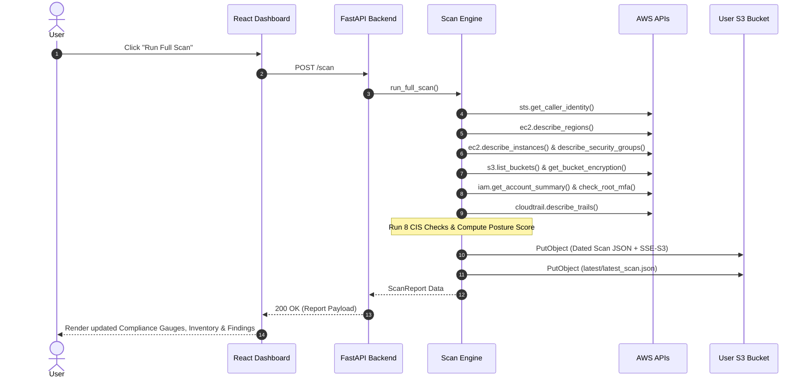

# Cloud Posture Scanner (CSPM)

An enterprise-grade, end-to-end **AWS Cloud Security Posture Management (CSPM)** application. It securely connects to your actual AWS account, discovers cloud compute and storage assets, evaluates configurations against **CIS AWS Foundations Benchmark** security standards, archives immutable JSON audit reports directly to your personal **Amazon S3** bucket, exposes comprehensive **FastAPI REST APIs**, and visualizes real-time compliance through a modern **React + TypeScript + Tailwind CSS** dashboard.

[](https://fastapi.tiangolo.com)
[](https://reactjs.org/)
[](https://www.typescriptlang.org/)
[](https://boto3.amazonaws.com/)
[](https://opensource.org/licenses/MIT)

---

## 1. Problem Statement

Modern cloud environments are dynamic and susceptible to misconfigurations—the primary cause of cloud security incidents. Organizations need continuous visibility into public exposure, unencrypted data, disabled logging, and unauthenticated management interfaces without incurring heavy operational overhead or subscribing to expensive multi-thousand-dollar enterprise CSPM tools.

**Cloud Posture Scanner** delivers automated, evidence-based, zero-cost cloud security evaluation engineered specifically around **AWS Free Tier** allowances:
- No provisioned databases (No DynamoDB, RDS, or MongoDB).
- No background daemons or billable polling infrastructure.
- 100% serverless data persistence in user-owned **Amazon S3 Standard** storage with SSE-S3 encryption.
- Read-only least-privilege IAM policies.

---

## 2. Key Features

- **Genuine AWS Account Connectivity**: Authenticates seamlessly via AWS CLI named profiles (`AWS_PROFILE=cloud-posture-scanner`) or the standard Boto3 credential provider chain with zero hardcoded keys.
- **Multi-Region Asset Discovery**:
  - Automatically queries enabled AWS regions via EC2 `DescribeRegions`.
  - Discovers all running, stopped, and terminated EC2 instances with public/private IPs, VPCs, subnets, and security groups.
  - Inspects all S3 buckets, retrieving default encryption status, Public Access Block settings, bucket policies, ACLs, and versioning status.
- **8 CIS-Inspired Security Benchmark Checks**:
  - `CIS-S3-001`: S3 Bucket Public Access Detection (Policy + ACL + PAB).
  - `CIS-S3-002`: S3 Default Server-Side Encryption Verification (AES256 / KMS).
  - `CIS-IAM-001`: Root Account Multi-Factor Authentication (MFA) Verification.
  - `CIS-LOG-001`: Multi-Region CloudTrail Logging & Status Inspection.
  - `CIS-NET-001`: Unrestricted SSH Public Exposure on Port 22 (`0.0.0.0/0` and `::/0`).
  - `CIS-NET-002`: Unrestricted RDP Public Exposure on Port 3389 (`0.0.0.0/0` and `::/0`).
  - `CIS-S3-003`: S3 Public Access Block 4-Setting Completeness Check.
  - `CIS-EC2-001`: EC2 Public Exposure Check (Public IP cross-referenced with open management ports).
- **Evidence-Based Evaluation**: Check results are strictly `PASS`, `FAIL`, or `ERROR` with verbatim audit evidence and actionable remediation steps. Unavailable data returns `ERROR`, never false `PASS`.
- **Automatic S3 Report Archival**: Completed scans are serialized and saved under `cloud-posture-scanner/scans/YYYY/MM/DD/scan_<id>.json` and updated at `latest/latest_scan.json` using SSE-S3 encryption.
- **Dedicated S3 Storage Verification**: Diagnostic test performs a live write, read, and delete of a temporary test object to verify bucket connectivity and encryption before scanning.
- **Interactive Modern UI**: Dark-themed dashboard built with React, Vite, Tailwind CSS, Lucide icons, and Recharts compliance visualization.

---

## 3. Architecture & Data Flow

### System Architecture



### Scan Execution Data Flow



---

## 4. Project Structure

```
cloud-posture-scanner/
├── backend/
│   ├── app/
│   │   ├── api/
│   │   │   └── routes/
│   │   │       ├── aws.py           # Identity & status endpoints
│   │   │       ├── buckets.py       # S3 inventory endpoints
│   │   │       ├── cis.py           # CIS benchmark findings
│   │   │       ├── health.py        # System health probe
│   │   │       ├── instances.py     # EC2 inventory endpoints
│   │   │       ├── scans.py         # Scan execution & history
│   │   │       └── storage.py       # S3 verification endpoint
│   │   ├── aws/
│   │   │   ├── cloudtrail.py        # CloudTrail trail inspection
│   │   │   ├── ec2.py               # Instances & regions discovery
│   │   │   ├── iam.py               # Account summary & root MFA
│   │   │   ├── s3.py                # S3 configuration discovery
│   │   │   ├── security_groups.py   # Security group rule parser
│   │   │   └── session.py           # Boto3 session & STS manager
│   │   ├── checks/
│   │   │   ├── base.py              # CheckResult dataclass & enums
│   │   │   ├── cloudtrail.py        # Check 4: Multi-region trail
│   │   │   ├── ec2_exposure.py      # Check 8: Public EC2 + port
│   │   │   ├── public_access_block.py # Check 7: S3 PAB complete
│   │   │   ├── rdp_exposure.py      # Check 6: Port 3389 exposure
│   │   │   ├── root_mfa.py          # Check 3: Root account MFA
│   │   │   ├── s3_encryption.py     # Check 2: Default encryption
│   │   │   ├── s3_public_access.py  # Check 1: S3 public exposure
│   │   │   └── ssh_exposure.py      # Check 5: Port 22 exposure
│   │   ├── schemas/
│   │   │   └── aws.py               # Pydantic v2 data models
│   │   ├── services/
│   │   │   ├── posture_score.py     # Posture score calculation
│   │   │   ├── report_storage.py    # S3 persistence & verification
│   │   │   ├── scan_state.py        # In-memory scan state
│   │   │   └── scanner.py           # Scan orchestrator service
│   │   ├── config.py                # Pydantic BaseSettings
│   │   └── main.py                  # FastAPI application entrypoint
│   ├── tests/                       # Pytest test suite with Moto
│   ├── Dockerfile
│   └── requirements.txt
├── frontend/
│   ├── src/
│   │   ├── components/              # Status badges, StatCards, Modals
│   │   ├── layouts/                 # Dashboard layout & navigation
│   │   ├── pages/
│   │   │   ├── Dashboard.tsx        # Overview with charts & stats
│   │   │   ├── EC2Inventory.tsx     # EC2 table with filters
│   │   │   ├── Findings.tsx         # CIS findings with evidence
│   │   │   ├── S3Inventory.tsx      # S3 bucket table
│   │   │   └── ScanHistory.tsx      # S3 history & report viewer
│   │   ├── services/                # Axios API services
│   │   ├── types/                   # TypeScript interfaces
│   │   ├── App.tsx
│   │   └── main.tsx
│   ├── package.json
│   ├── vite.config.ts
│   └── Dockerfile
├── infrastructure/
│   ├── iam-policy.json              # Least-privilege IAM policy
│   └── s3-setup.md                  # S3 bucket manual creation guide
├── docs/
│   ├── architecture.md              # Detailed architecture docs
│   ├── aws-setup.md                 # AWS CLI & account setup guide
│   └── cis-checks.md                # Benchmark rules documentation
├── .env.example
├── .gitignore
├── docker-compose.yml
├── LICENSE
└── README.md
```

---

## 5. Technology Stack

- **Backend**: Python 3.11+, FastAPI, Boto3, Pydantic v2, Uvicorn.
- **Testing**: Pytest, Moto (mock_aws for STS, S3, EC2, IAM, CloudTrail), FastAPI TestClient.
- **Frontend**: React 18, TypeScript, Vite, Tailwind CSS, Recharts, Lucide React, Axios, React Hot Toast.
- **Cloud Storage**: AWS S3 Standard (Server-Side Encryption with SSE-S3).

---

## 6. AWS Security & Least-Privilege IAM Policy

Attach the least-privilege policy located in `infrastructure/iam-policy.json` to your dedicated IAM user. Replace `YOUR-REPORT-BUCKET-NAME` with your actual S3 bucket:

```json
{
  "Version": "2012-10-17",
  "Statement": [
    {
      "Sid": "STSIdentityVerification",
      "Effect": "Allow",
      "Action": ["sts:GetCallerIdentity"],
      "Resource": "*"
    },
    {
      "Sid": "EC2ReadAccess",
      "Effect": "Allow",
      "Action": [
        "ec2:DescribeRegions",
        "ec2:DescribeInstances",
        "ec2:DescribeSecurityGroups"
      ],
      "Resource": "*"
    },
    {
      "Sid": "S3BucketDiscovery",
      "Effect": "Allow",
      "Action": [
        "s3:ListAllMyBuckets",
        "s3:GetBucketLocation",
        "s3:GetEncryptionConfiguration",
        "s3:GetBucketPolicy",
        "s3:GetBucketPolicyStatus",
        "s3:GetBucketPublicAccessBlock",
        "s3:GetBucketAcl",
        "s3:GetBucketVersioning"
      ],
      "Resource": "arn:aws:s3:::*"
    },
    {
      "Sid": "S3ReportBucketReadWrite",
      "Effect": "Allow",
      "Action": ["s3:ListBucket"],
      "Resource": "arn:aws:s3:::YOUR-REPORT-BUCKET-NAME"
    },
    {
      "Sid": "S3ReportObjectsReadWrite",
      "Effect": "Allow",
      "Action": [
        "s3:PutObject",
        "s3:GetObject",
        "s3:DeleteObject"
      ],
      "Resource": "arn:aws:s3:::YOUR-REPORT-BUCKET-NAME/cloud-posture-scanner/*"
    },
    {
      "Sid": "IAMReadAccess",
      "Effect": "Allow",
      "Action": [
        "iam:GetAccountSummary",
        "iam:GenerateCredentialReport",
        "iam:GetCredentialReport"
      ],
      "Resource": "*"
    },
    {
      "Sid": "CloudTrailReadAccess",
      "Effect": "Allow",
      "Action": [
        "cloudtrail:DescribeTrails",
        "cloudtrail:GetTrailStatus"
      ],
      "Resource": "*"
    }
  ]
}
```

---

## 7. Setup & Local Execution Guide

### Prerequisites
1. **Python 3.11+** installed.
2. **Node.js 18+** and `npm` installed.
3. **AWS CLI** configured with your named profile:
   ```bash
   aws configure --profile cloud-posture-scanner
   ```
4. A manually created S3 Bucket in AWS (e.g. in region `ap-southeast-2`).

### Step 1: Clone & Configure Environment

```bash
git clone https://github.com/your-username/cloud-posture-scanner.git
cd cloud-posture-scanner

cp .env.example .env
```

Edit `.env`:
```env
AWS_PROFILE=cloud-posture-scanner
AWS_REGION=ap-southeast-2
POSTURE_RESULTS_BUCKET=your-actual-bucket-name
APP_ENV=development
DEBUG=false
```

### Step 2: Backend Setup & Run

```bash
cd backend

# Create virtual environment
python -m venv venv

# Windows activate:
venv\Scripts\activate
# Linux/macOS activate:
# source venv/bin/activate

# Install dependencies
pip install -r requirements.txt

# Start FastAPI server
uvicorn app.main:app --reload --port 8000
```
- Backend API Docs: [http://localhost:8000/docs](http://localhost:8000/docs)
- Health Check: [http://localhost:8000/health](http://localhost:8000/health)

### Step 3: Frontend Setup & Run

In a second terminal window:

```bash
cd frontend

# Install packages
npm install

# Start Vite dev server
npm run dev
```
- Web Dashboard: [http://localhost:5173](http://localhost:5173)

---

## 8. Docker Compose Support (Optional)

You can also run both services locally with Docker Compose:

```bash
docker-compose up --build
```
*(Mounts your `~/.aws` folder as read-only to grant the container access to your local AWS CLI profile credentials without baking any keys into the image).*

---

## 9. Automated Testing

### Backend Unit & Integration Tests (Pytest + Moto)

The backend test suite executes without requiring live AWS credentials:

```bash
cd backend
pytest -v
```

Tests cover:
- STS identity verification and credential error handling.
- EC2 instance and Security Group discovery with pagination.
- S3 bucket discovery and configuration evaluation.
- All 8 CIS security checks across PASS, FAIL, and ERROR states.
- Dedicated S3 storage verification (write/read/delete/SSE-S3).
- Full scan orchestration and posture score formula.
- FastAPI REST API endpoints.

### Frontend Tests (Vitest)

```bash
cd frontend
npm run test
```

---

## 10. CIS-Inspired Security Checks Summary

| ID | Benchmark Name | Category | Severity | Evaluation Criteria |
|---|---|---|---|---|
| `CIS-S3-001` | S3 Public Access | Storage | HIGH | FAIL if bucket policy, ACL, or missing PAB exposes bucket |
| `CIS-S3-002` | S3 Default Encryption | Storage | HIGH | FAIL if default SSE-S3 (AES256) or SSE-KMS is disabled |
| `CIS-IAM-001` | Root Account MFA | Identity | CRITICAL | FAIL if root MFA is absent; ERROR if IAM permissions denied |
| `CIS-LOG-001` | CloudTrail Multi-Region | Logging | HIGH | FAIL if no multi-region trail is actively logging |
| `CIS-NET-001` | SSH Public Exposure | Network | HIGH | FAIL if TCP port 22 is open to `0.0.0.0/0` or `::/0` |
| `CIS-NET-002` | RDP Public Exposure | Network | HIGH | FAIL if TCP port 3389 is open to `0.0.0.0/0` or `::/0` |
| `CIS-S3-003` | S3 Public Access Block | Storage | MEDIUM | FAIL if any of the 4 PAB block settings are missing/false |
| `CIS-EC2-001` | EC2 Public Instance Exposure | Compute | MEDIUM | FAIL if running instance has a public IP AND exposed management port |

---

## 11. Security Posture Score Formula

$$\text{Posture Score} = \frac{\text{PASS Count}}{\text{PASS Count} + \text{FAIL Count}} \times 100$$

- **ERROR** checks are explicitly omitted from the score calculation denominator so unverified checks do not artificially inflate or deflate compliance.
- If zero checks can be evaluated, the score renders as **N/A**.

---

## 13. License

This project is licensed under the MIT License - see the [LICENSE](LICENSE) file for details.

