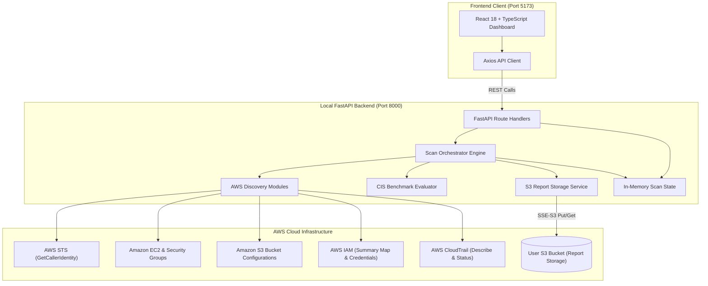
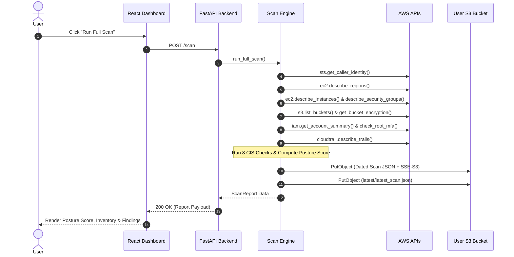

# Cloud Posture Scanner

An open-source, full-stack **AWS Cloud Security Posture Management (CSPM)** application designed to discover cloud infrastructure misconfigurations, evaluate security postures against CIS-inspired benchmarks, archive structured JSON audit reports to Amazon S3, and present findings through an interactive web dashboard.

> **Note on Compliance Standards**: This tool performs security evaluations inspired by the **CIS AWS Foundations Benchmark v1.4.0 / v2.0.0**. It is an independent portfolio and educational project and is not formally certified or endorsed by the Center for Internet Security (CIS).

[](https://fastapi.tiangolo.com)
[](https://reactjs.org/)
[](https://www.typescriptlang.org/)
[](https://boto3.amazonaws.com/)
[](LICENSE)

---

## 1. Project Overview & Design Principles

Cloud misconfigurations—such as publicly accessible S3 buckets, open administrative ports, unencrypted storage, and absent multi-factor authentication—remain the primary root cause of cloud security incidents.

**Cloud Posture Scanner** is built with a cost-conscious architecture that operates within standard **AWS Free Tier** allowances:
- **Zero Paid Databases**: Persists all scan reports directly to user-owned **Amazon S3 Standard** storage using server-side encryption (`SSE-S3`), eliminating DynamoDB or RDS infrastructure costs.
- **No Recurring Background Polling**: Executes scans on-demand through FastAPI REST endpoints without continuous CloudWatch or Lambda invocations.
- **Least-Privilege Security**: Requires read-only IAM access to AWS APIs for asset inspection and restricted write access limited strictly to the designated S3 report prefix.
- **Strict Evidence-Based Reporting**: Checks return `PASS`, `FAIL`, or `ERROR` with concrete audit evidence. If an API call fails or permissions are missing, the system records an explicit `ERROR` rather than a false `PASS`.

---

## 2. Key Features

- **Profile-Based AWS Authentication**: Connects securely via AWS CLI named profiles (`AWS_PROFILE=cloud-posture-scanner`) or standard Boto3 credential resolution without hardcoding API keys.
- **Multi-Region Asset Discovery**:
  - Dynamically discovers enabled AWS regions via EC2 `DescribeRegions`.
  - Discovers running and stopped EC2 instances across enabled regions (terminated instances are reported only while temporarily retained by the EC2 service before being purged), mapping VPCs, subnets, public/private IPs, and security groups.
  - Inspects all accessible S3 buckets, evaluating default server-side encryption (SSE-S3 / KMS), Public Access Block configurations, bucket policies, ACLs, and versioning status.
- **8 CIS-Inspired Security Checks**:
  1. `CIS-S3-001`: S3 Bucket Public Access Detection (Bucket Policies, Public ACLs, Public Access Block).
  2. `CIS-S3-002`: S3 Default Server-Side Encryption Verification (`AES256` or `aws:kms`).
  3. `CIS-IAM-001`: AWS Account Root User Multi-Factor Authentication (MFA) Verification.
  4. `CIS-LOG-001`: Multi-Region CloudTrail Logging & Status Inspection.
  5. `CIS-NET-001`: Unrestricted SSH Public Exposure on Port 22 (`0.0.0.0/0` and `::/0`).
  6. `CIS-NET-002`: Unrestricted RDP Public Exposure on Port 3389 (`0.0.0.0/0` and `::/0`).
  7. `CIS-S3-003`: S3 Public Access Block 4-Setting Completeness Check.
  8. `CIS-EC2-001`: EC2 Public Instance Exposure Check (Public IP cross-referenced with open management ports).
- **Automated S3 Report Archival**:
  - Automatically saves completed scan reports under `cloud-posture-scanner/scans/YYYY/MM/DD/scan_<id>.json`.
  - Updates the pointer at `cloud-posture-scanner/latest/latest_scan.json` with SSE-S3 encryption (`AES256`).
  - Dynamically determines the actual target bucket region via S3 `GetBucketLocation` to ensure reliable uploads even if the bucket resides in a region different from the default client region.
- **Pre-Flight S3 Storage Verification**: Diagnostic test performs a live write, read, and delete of a temporary test object to verify bucket connectivity and SSE-S3 encryption permissions prior to scanning.
- **Full-Featured React Dashboard**: Dark-themed dashboard built with React 18, Vite, Tailwind CSS, Lucide icons, and Recharts visualization.

---

## 3. Architecture & Data Flow

### System Architecture



### Scan Execution Flow



---

## 4. Project Structure

```
cloud-posture-scanner/
├── backend/
│   ├── app/
│   │   ├── api/
│   │   │   └── routes/
│   │   │       ├── aws.py             # AWS identity & status endpoints
│   │   │       ├── buckets.py         # S3 inventory endpoints
│   │   │       ├── cis.py             # CIS benchmark findings
│   │   │       ├── health.py          # System health probe (/health)
│   │   │       ├── instances.py       # EC2 inventory endpoints
│   │   │       ├── scans.py           # Scan execution & history retrieval
│   │   │       └── storage.py         # S3 storage self-test verification
│   │   ├── aws/
│   │   │   ├── cloudtrail.py          # CloudTrail trail inspection
│   │   │   ├── ec2.py                 # EC2 instance & region discovery
│   │   │   ├── iam.py                 # IAM account summary & root MFA
│   │   │   ├── s3.py                  # S3 configuration discovery
│   │   │   ├── security_groups.py     # Security group ingress rule parser
│   │   │   └── session.py             # Boto3 session & STS manager
│   │   ├── checks/
│   │   │   ├── base.py                # Base check classes, enums & models
│   │   │   ├── cloudtrail.py          # CIS-LOG-001: CloudTrail multi-region
│   │   │   ├── ec2_exposure.py        # CIS-EC2-001: Public EC2 instance exposure
│   │   │   ├── public_access_block.py # CIS-S3-003: S3 PAB configuration
│   │   │   ├── rdp_exposure.py        # CIS-NET-002: Port 3389 exposure
│   │   │   ├── root_mfa.py            # CIS-IAM-001: Root account MFA
│   │   │   ├── s3_encryption.py       # CIS-S3-002: S3 default encryption
│   │   │   ├── s3_public_access.py    # CIS-S3-001: S3 public exposure
│   │   │   └── ssh_exposure.py        # CIS-NET-001: Port 22 exposure
│   │   ├── schemas/
│   │   │   └── aws.py                 # Pydantic v2 data models
│   │   ├── services/
│   │   │   ├── posture_score.py       # Compliance score calculator
│   │   │   ├── report_storage.py      # S3 report persistence & verification
│   │   │   ├── scan_state.py          # In-memory scan state management
│   │   │   └── scanner.py             # Scan orchestration service
│   │   ├── config.py                  # Pydantic BaseSettings configuration
│   │   └── main.py                    # FastAPI application initialization
│   ├── tests/                         # Pytest test suite with Moto mocks
│   │   ├── conftest.py                # Test fixtures & mocked AWS setup
│   │   ├── test_api.py                # API route integration tests
│   │   ├── test_aws_session.py        # Boto3 session & STS tests
│   │   ├── test_checks.py             # All 8 CIS check unit tests
│   │   ├── test_ec2_discovery.py      # EC2 discovery tests
│   │   ├── test_s3_discovery.py       # S3 discovery tests
│   │   ├── test_scanner.py            # Scanner & posture score tests
│   │   └── test_storage.py            # S3 storage & retrieval tests
│   ├── Dockerfile
│   └── requirements.txt               # Backend dependencies
├── frontend/
│   ├── src/
│   │   ├── components/                # Reusable UI cards, tables, modals
│   │   ├── layouts/                   # DashboardLayout & navigation sidebar
│   │   ├── pages/
│   │   │   ├── Dashboard.tsx          # Overview stats, score & quick actions
│   │   │   ├── EC2Inventory.tsx       # EC2 instances inventory table
│   │   │   ├── Findings.tsx           # CIS findings table with evidence drawer
│   │   │   ├── S3Inventory.tsx        # S3 bucket configuration table
│   │   │   └── ScanHistory.tsx        # Historical S3 report viewer
│   │   ├── services/                  # Axios API client functions
│   │   ├── types/                     # TypeScript domain interfaces
│   │   ├── App.tsx
│   │   └── main.tsx
│   ├── package.json                   # Frontend dependencies
│   ├── package-lock.json
│   ├── tailwind.config.js
│   ├── vite.config.ts
│   └── Dockerfile
├── infrastructure/
│   ├── iam-policy.json                # Least-privilege IAM policy template
│   └── s3-setup.md                    # S3 bucket creation & configuration guide
├── docs/
│   ├── architecture.md                # System architecture documentation
│   ├── aws-setup.md                   # AWS CLI & named profile setup guide
│   └── cis-checks.md                  # Comprehensive benchmark specifications
├── .env.example                       # Environment configuration template
├── .gitignore                         # Security-hardened gitignore
├── docker-compose.yml                 # Local multi-container definition
├── LICENSE                            # MIT License
└── README.md
```

---

## 5. Technology Stack

### Backend
- **Framework**: [FastAPI](https://fastapi.tiangolo.com/) (Python 3.11+)
- **Server**: [Uvicorn](https://www.uvicorn.org/) (ASGI server)
- **AWS SDK**: [Boto3](https://boto3.amazonaws.com/v1/documentation/api/latest/index.html) and [Botocore](https://botocore.amazonaws.com/v1/documentation/api/latest/index.html)
- **Data Validation & Settings**: [Pydantic v2](https://docs.pydantic.dev/) and `pydantic-settings`
- **Testing**: [Pytest](https://docs.pytest.org/), `pytest-asyncio`, `pytest-cov`, and [Moto](https://docs.getmoto.org/) (`mock_aws`)

### Frontend
- **Core**: [React 18](https://react.dev/), [TypeScript 5](https://www.typescriptlang.org/)
- **Build Tool**: [Vite 5](https://vitejs.dev/)
- **Styling**: [Tailwind CSS 3](https://tailwindcss.com/)
- **Data Visualization**: [Recharts](https://recharts.org/)
- **Icons**: [Lucide React](https://lucide.dev/)
- **HTTP Client**: [Axios](https://axios-http.com/)
- **Testing**: [Vitest](https://vitest.dev/), React Testing Library, JSDOM

### Persistence
- **Storage**: Amazon S3 Standard (Server-Side Encryption with `SSE-S3`)

---

## 6. AWS Security & Least-Privilege IAM Policy

The application follows the principle of least privilege. It requires read-only permissions for AWS asset discovery and restricted write access limited strictly to your chosen S3 report bucket.

### Summary of Required Permissions

| Service | Actions | Purpose |
| :--- | :--- | :--- |
| **AWS STS** | `sts:GetCallerIdentity` | Validates active credentials, account ID, and caller ARN. |
| **Amazon EC2** | `ec2:DescribeRegions`, `ec2:DescribeInstances`, `ec2:DescribeSecurityGroups` | Discovers enabled regions, running/stopped instances, and security group ingress rules. |
| **Amazon S3** | `s3:ListAllMyBuckets`, `s3:GetBucketLocation`, `s3:GetEncryptionConfiguration`, `s3:GetBucketPolicy`, `s3:GetBucketPolicyStatus`, `s3:GetBucketPublicAccessBlock`, `s3:GetBucketAcl`, `s3:GetBucketVersioning` | Discovers and inspects security configurations across all accessible buckets. |
| **Amazon S3 (Reports)** | `s3:ListBucket`, `s3:PutObject`, `s3:GetObject`, `s3:DeleteObject` | Scoped **only** to `arn:aws:s3:::YOUR-REPORT-BUCKET-NAME` and the prefix `cloud-posture-scanner/*` for report archival and storage verification. |
| **AWS IAM** | `iam:GetAccountSummary`, `iam:GenerateCredentialReport`, `iam:GetCredentialReport` | Evaluates root user multi-factor authentication (MFA) status. |
| **AWS CloudTrail**| `cloudtrail:DescribeTrails`, `cloudtrail:GetTrailStatus` | Inspects multi-region logging trails and logging active status. |

The complete, deployable IAM policy template is maintained in [infrastructure/iam-policy.json](infrastructure/iam-policy.json). To attach it:
1. Open the IAM console and create a policy using [`infrastructure/iam-policy.json`](infrastructure/iam-policy.json).
2. Replace `YOUR-REPORT-BUCKET-NAME` with your actual S3 bucket name.
3. Attach the policy to your dedicated IAM user (e.g., `cloud-posture-scanner`).

---

## 7. Configuration & Environment Variables

Copy the provided template to create your local `.env`:

```bash
cp .env.example .env
```

### Environment Variables Reference

| Variable | Required | Default / Example | Description |
| :--- | :---: | :--- | :--- |
| `AWS_PROFILE` | Yes | `cloud-posture-scanner` | AWS CLI named profile containing your credentials. |
| `AWS_REGION` | Yes | `ap-southeast-2` | Default AWS region for API clients. You can set this to any AWS region. |
| `POSTURE_RESULTS_BUCKET` | Yes | `your-existing-bucket-name` | Pre-existing Amazon S3 bucket used to store scan reports. |
| `APP_ENV` | No | `development` | Application runtime environment (`development` or `production`). |
| `DEBUG` | No | `false` | Enable verbose debug logging. |
| `CORS_ORIGINS` | No | `http://localhost:5173,http://localhost:3000` | Comma-separated list of allowed frontend origins. |

> **Note on S3 Region Resolution**: The backend dynamically queries `GetBucketLocation` on `POSTURE_RESULTS_BUCKET`. S3 operations automatically use the bucket's actual hosting region, ensuring compatibility even if your S3 bucket resides in a region different from `AWS_REGION`.

---

## 8. Local Setup & Execution Guide

### Prerequisites
1. **Python 3.11+** installed.
2. **Node.js 18+** and `npm` installed.
3. **AWS CLI** installed and configured with a named profile:
   ```bash
   aws configure --profile cloud-posture-scanner
   ```
4. A pre-created private S3 bucket with default SSE-S3 encryption enabled (see [infrastructure/s3-setup.md](infrastructure/s3-setup.md)).

---

### Step 1: Configure Environment

```bash
# Clone the repository
git clone https://github.com/<your-username>/cloud-posture-scanner.git
cd cloud-posture-scanner

# Copy template and fill in your bucket name
cp .env.example .env
```

---

### Step 2: Backend Setup & Execution

Open a terminal window:

```bash
cd backend

# Create virtual environment
python -m venv venv

# Activate virtual environment
# Windows (PowerShell / Command Prompt):
.\venv\Scripts\activate
# Linux / macOS:
# source venv/bin/activate

# Install dependencies
pip install -r requirements.txt

# Start FastAPI server
uvicorn app.main:app --reload --port 8000
```

- **API Documentation (Swagger UI)**: [http://localhost:8000/docs](http://localhost:8000/docs)
- **Health Check Probe**: [http://localhost:8000/health](http://localhost:8000/health)

---

### Step 3: Frontend Setup & Execution

Open a second terminal window:

```bash
cd frontend

# Install dependencies
npm install

# Start Vite development server
npm run dev
```

- **Web Dashboard**: [http://localhost:5173](http://localhost:5173)

---

## 9. Docker Compose Support (Optional)

You can also run both the backend and frontend locally using Docker Compose:

```bash
docker-compose up --build
```

### Docker AWS Credentials Mounting
The `docker-compose.yml` mounts your local `~/.aws` directory into the backend container as **read-only** (`:ro`):
```yaml
volumes:
  - ~/.aws:/root/.aws:ro
```
This enables the containerized Boto3 client to authenticate seamlessly using your host's AWS CLI named profile (`cloud-posture-scanner`) without baking access keys into Docker images.

*(On Windows hosts using Docker Desktop, ensure your user profile's `.aws` directory is accessible, or map `${USERPROFILE}/.aws:/root/.aws:ro`).*

---

## 10. Automated Testing

The project includes unit, integration, and UI test suites. All automated tests run against simulated mocks and do not require live AWS credentials or network connectivity.

### Backend Tests (Pytest + Moto)

The backend test suite uses [Moto](https://docs.getmoto.org/) to mock AWS services (`STS`, `EC2`, `S3`, `IAM`, `CloudTrail`):

```bash
cd backend
pytest -v
```

**Test Coverage**:
- STS caller identity verification and error scenarios.
- Multi-region EC2 instance and Security Group discovery.
- S3 bucket configuration evaluation (Public Access Block, SSE-S3, bucket policies, ACLs).
- All 8 CIS benchmark checks across `PASS`, `FAIL`, and `ERROR` states.
- Dedicated S3 storage self-test verification (write, read, delete, SSE-S3 header enforcement).
- Full scan orchestration, historical report retrieval, and posture score calculation.
- FastAPI REST endpoints.

*(Test suite verification: 39 passing tests executed with zero failures).*

### Frontend Tests (Vitest)

```bash
cd frontend
npm run test
```

### Frontend Production Build Verification

```bash
cd frontend
npm run build
```

---

## 11. CIS-Inspired Security Checks Reference

| Check ID | Title | Category | Severity | Evaluation Logic |
| :--- | :--- | :--- | :---: | :--- |
| `CIS-S3-001` | S3 Public Access | Storage | **HIGH** | `FAIL` if bucket policy allows public access, public ACL grants exist, or Public Access Block is disabled. |
| `CIS-S3-002` | S3 Default Encryption | Storage | **HIGH** | `FAIL` if default server-side encryption (`AES256` or `aws:kms`) is not configured on the bucket. |
| `CIS-IAM-001` | Root Account MFA | Identity | **CRITICAL** | `FAIL` if root account multi-factor authentication is not active; `ERROR` if IAM permissions are restricted. |
| `CIS-LOG-001` | CloudTrail Multi-Region | Logging | **HIGH** | `FAIL` if no multi-region CloudTrail is actively logging management events. |
| `CIS-NET-001` | SSH Public Exposure | Network | **HIGH** | `FAIL` if any security group allows inbound TCP port 22 from `0.0.0.0/0` or `::/0`. |
| `CIS-NET-002` | RDP Public Exposure | Network | **HIGH** | `FAIL` if any security group allows inbound TCP port 3389 from `0.0.0.0/0` or `::/0`. |
| `CIS-S3-003` | S3 Public Access Block Completeness | Storage | **MEDIUM** | `FAIL` if any of the 4 Public Access Block settings (`BlockPublicAcls`, `IgnorePublicAcls`, `BlockPublicPolicy`, `RestrictPublicBuckets`) is missing or false. |
| `CIS-EC2-001` | EC2 Public Instance Exposure | Compute | **MEDIUM** | `FAIL` if a running instance has a public IP address AND an attached security group exposing port 22 or 3389 to `0.0.0.0/0` or `::/0`. |

Detailed check rationales, audit CLI commands, and remediation instructions are documented in [docs/cis-checks.md](docs/cis-checks.md).

---

## 12. Security Posture Score Formula

The security posture score provides a normalized compliance percentage (0–100%):

$$\text{Posture Score} = \frac{\text{PASS Count}}{\text{PASS Count} + \text{FAIL Count}} \times 100$$

- **ERROR Treatment**: Checks resulting in `ERROR` (e.g., due to insufficient read permissions) are deliberately excluded from both the numerator and the denominator so unverified checks do not artificially inflate or deflate the posture score.
- **Indeterminate State**: If zero checks can be evaluated, the score renders as **N/A**.

---

## 13. REST API Endpoints Summary

| Method | Endpoint | Description |
| :--- | :--- | :--- |
| `GET` | `/health` | System health check probe. |
| `GET` | `/aws/status` | Current AWS configuration (profile, region, configured bucket). |
| `POST` | `/aws/verify` | Verifies AWS STS caller identity and account ID. |
| `POST` | `/storage/verify` | Runs pre-flight live write/read/delete self-test on the target S3 bucket. |
| `POST` | `/scan` | Executes full multi-region asset discovery and security evaluations. |
| `GET` | `/scan/latest` | Retrieves the latest stored scan report directly from S3. |
| `GET` | `/scan/history` | Lists historical scan summaries retrieved from S3. |
| `GET` | `/scan/summary` | Retrieves the latest scan summary from in-memory state. |
| `GET` | `/scan/{scan_id}` | Retrieves a specific scan report by scan ID from S3. |
| `GET` | `/instances` | Returns inventory of discovered EC2 instances. |
| `GET` | `/buckets` | Returns inventory of discovered S3 buckets and configurations. |
| `GET` | `/cis/checks` | Lists definitions of all 8 supported CIS-inspired checks. |
| `GET` | `/cis/findings` | Returns evaluation findings from the latest scan. |

---

## 14. License

This project is licensed under the MIT License - see the [LICENSE](LICENSE) file for details.
