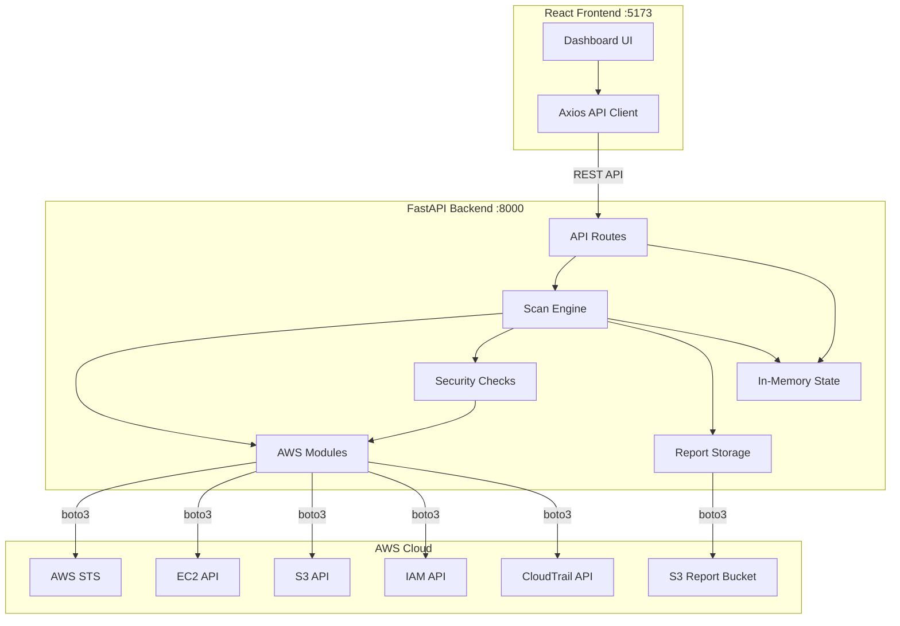
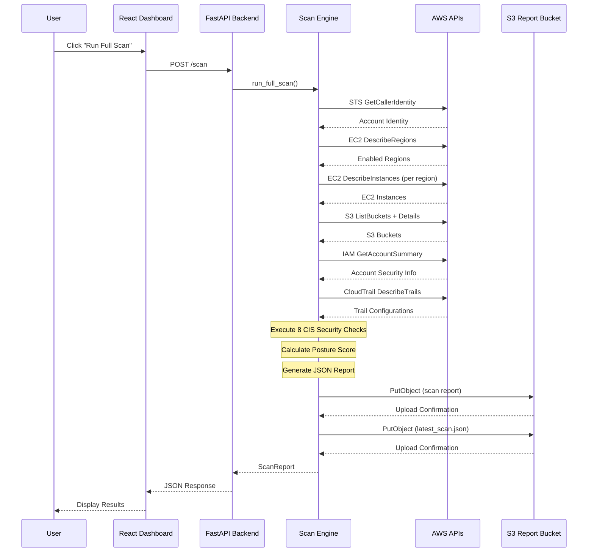

# Architecture

## System Overview

Cloud Posture Scanner is a Cloud Security Posture Management (CSPM) tool that evaluates AWS account security configurations against CIS AWS Foundations Benchmark-inspired checks.

## Architecture Diagram

## Data Flow Diagram

## Component Architecture

### Backend Components

| Component | Responsibility |
|-----------|---------------|
| `app/aws/session.py` | AWS session management, credential handling |
| `app/aws/ec2.py` | EC2 instance and region discovery |
| `app/aws/s3.py` | S3 bucket discovery and configuration analysis |
| `app/aws/iam.py` | IAM account summary and credential reports |
| `app/aws/cloudtrail.py` | CloudTrail trail discovery and status |
| `app/aws/security_groups.py` | Security group analysis for port exposure |
| `app/checks/*.py` | Individual CIS-inspired security checks |
| `app/services/scanner.py` | Scan orchestration engine |
| `app/services/report_storage.py` | S3 report upload, retrieval, and management |
| `app/services/posture_score.py` | Security posture score calculation |
| `app/services/scan_state.py` | In-memory scan state management |
| `app/api/routes/*.py` | REST API endpoints |
| `app/schemas/*.py` | Pydantic data models |

### Frontend Components

| Component | Responsibility |
|-----------|---------------|
| `pages/Dashboard.tsx` | Overview with stats, charts, and actions |
| `pages/EC2Inventory.tsx` | Searchable EC2 instance table |
| `pages/S3Inventory.tsx` | Searchable S3 bucket table |
| `pages/Findings.tsx` | CIS security findings with filters |
| `pages/ScanHistory.tsx` | Historical scan reports from S3 |
| `layouts/DashboardLayout.tsx` | Sidebar navigation and layout |
| `services/api.ts` | Axios-based API client |
| `hooks/useApi.ts` | React hook for API state management |

## Security Architecture

- **No stored credentials**: Uses AWS CLI named profiles or standard credential chain
- **Least-privilege IAM**: Read-only access to AWS resources, write only to report bucket
- **No resource modification**: Application never creates, modifies, or deletes AWS resources
- **No data inspection**: Never downloads or reads actual S3 object contents
- **Encryption**: All reports stored with SSE-S3 encryption
- **CORS**: Restricted to configured frontend origins
- **No secrets in frontend**: All AWS operations happen server-side

## Deployment Model

The application runs entirely locally:
- Backend: Python/FastAPI on port 8000
- Frontend: React/Vite on port 5173
- Storage: AWS S3 (remote, managed by AWS)

No cloud infrastructure is provisioned. Only S3 is used for persistent storage.

